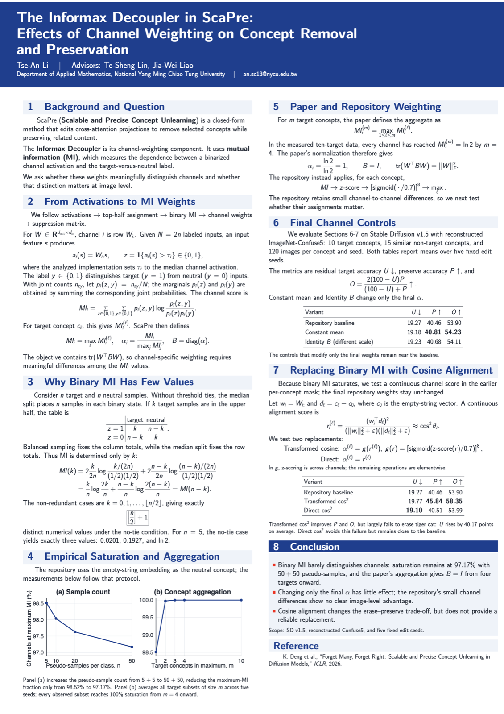

# Machine Unlearning in Text-to-Image Diffusion Models

Summer research project on removing selected concepts from diffusion models
while preserving related content. This repository contains method implementations,
controlled experiments, evaluation records, and the final report and poster.

**[Poster](scapre_poster_gemini_a1_portrait/poster.pdf)** ·
**[Full report](ScaPre_Informax_report_complete/scapre_informax_report.pdf)** ·
**[Results](#results-and-experiments)** · **[Download](#download)**

## About the project

Concept unlearning aims to stop a model from generating a chosen concept without
losing its ability to generate other content. Closely related concepts make this
difficult: removing one dog breed, for example, should preserve other breeds.

This project studies that removal–preservation trade-off in Stable Diffusion,
with experiments built around ScaPre and Orthogonal Concept Erasure (OCE).
The final study focuses on **ScaPre's Informax Decoupler**: does its mutual
information (MI) score distinguish channels, and does the assignment of channel
weights affect image-level results?

The experiments examine MI saturation, aggregation across target concepts,
five-seed channel-weight controls, reference selection, and exploratory
squared-cosine alternatives. This is an independent research repository;
the original method implementations are credited [below](#upstream-methods).

## Report and poster

**The Informax Decoupler in ScaPre: Effects of Channel Weighting on Concept
Removal and Preservation**<br>
Tse-An Li · Advisors: Te-Sheng Lin and Jia-Wei Liao<br>
Department of Applied Mathematics, National Yang Ming Chiao Tung University · September 2026

<p align="center">
  <a href="scapre_poster_gemini_a1_portrait/poster.pdf">
    
  </a>
</p>

| Material | Contents |
| --- | --- |
| [Poster PDF](scapre_poster_gemini_a1_portrait/poster.pdf) | A1 portrait overview of the study |
| [Full report PDF](ScaPre_Informax_report_complete/scapre_informax_report.pdf) | Derivations, protocol, results, and interpretation |
| [Poster source](scapre_poster_gemini_a1_portrait/README.md) | LaTeX source, figures, and compilation instructions |
| [Report bundle](ScaPre_Informax_report_complete/README.md) | LaTeX source, vector figures, result tables, and supporting notes |

## Main findings

- **Binary MI saturates under the tested empty-string reference.** With
  `5 + 5` target and neutral pseudo-samples, about 98.5% of observations reach
  maximum MI. Increasing to `50 + 50` leaves about 97.2% at the maximum.
- **Aggregation further reduces channel resolution.** In the measured ten-target
  data, every channel reaches maximum MI for every tested subset of four or more
  targets.
- **Final channel assignments have little measured effect in these controls.**
  Across five edit seeds, constant, shuffled, and all-ones final weights produce
  image metrics close to the repository baseline. Earlier Informax weighting
  remains active, so this does not test removal of the whole Decoupler.
- **The follow-up alternatives do not establish a replacement method.** Reference
  selection changes the trade-off, but matched-retain uses evaluation concepts
  and serves as a diagnostic. The tested squared-cosine variants do not give a
  consistent improvement.

Image-level comparisons use Stable Diffusion v1.5 and a project-specific
reconstruction of ImageNet-Confuse5: 10 targets, 15 similar retain concepts,
and 120 images per concept and seed. These findings apply to the tested
protocol; the absolute accuracies are not an exact reproduction of the original
paper's Table 7. See the [report](ScaPre_Informax_report_complete/scapre_informax_report.pdf)
for the full scope and limitations.

## Download

Clone the repository:

```bash
git clone https://github.com/daniel2314069/Machine-Unlearning-Summer-Research-Project.git
cd Machine-Unlearning-Summer-Research-Project
```

Or **[download the repository as a ZIP](https://github.com/daniel2314069/Machine-Unlearning-Summer-Research-Project/archive/refs/heads/main.zip)**
and extract it. To read the study without downloading the code, open the
[poster PDF](scapre_poster_gemini_a1_portrait/poster.pdf) or
[report PDF](ScaPre_Informax_report_complete/scapre_informax_report.pdf)
and use GitHub's download button.

The repository includes source code, configurations, compiled PDFs, and selected
result tables and manifests. Model weights, downloaded datasets, raw experiment
archives, caches, and bulk generated images are stored separately.
Reading the report and results requires no Python or GPU setup.

## Results and experiments

| Study | Entry point |
| --- | --- |
| Informax specificity and reference diagnostics | [Experiment overview and results](experiments/scapre_informax_specificity/README.md) |
| MI saturation, sample size, and target-count analysis | [MI diagnostics](experiments/scapre_informax_specificity/analysis/mi_channel_weighting/README.md) |
| Five-seed final channel-weight controls | [Controls and protocol](experiments/scapre_informax_specificity/analysis/alpha_channel_controls/README.md) · [Formal results](experiments/scapre_informax_specificity/analysis/alpha_channel_controls/formal_results/README.md) |
| Squared-cosine follow-up | [Direct score](experiments/scapre_informax_specificity/analysis/projection_accumulation_direct_cos2/README.md) · [Budget-matched score](experiments/scapre_informax_specificity/analysis/projection_accumulation_budget_matched_cos2/README.md) |
| OCE experiments and shared evaluation references | [Experiment index](orthogonal-concept-erasure/experiments/README.md) · [Local playbook](orthogonal-concept-erasure/OCE_LOCAL_PLAYBOOK.md) |

Each experiment directory documents its own protocol and result status.
The report brings together the completed Informax study; older and abandoned
experiments remain in the repository with their recorded dispositions.

## Running experiments

Image experiments require a CUDA GPU, model assets, and the dependencies for the
selected experiment. There is no single environment file for every method.
Start with the relevant experiment README rather than combining the upstream
dependency lists.

For the project's configured GPU server, log in with `ssh tslin`. The existing
server checkout and Conda `MU` environment use this setup command:

```bash
cd /home/tslin/Documents/jupyter_data/anLi/machine_unlearning
conda activate MU
experiments/scapre_informax_specificity/setup_server.sh
```

Setup installs the pinned experiment dependencies and downloads the required
Stable Diffusion v1.5 and classifier assets. Then launch the smoke test:

```bash
experiments/scapre_informax_specificity/run_server.sh smoke
experiments/scapre_informax_specificity/status_server.sh
```

The launcher runs the worker detached and checks that it starts successfully
before reporting that SSH can be closed. Wait for `completed` and exit code `0`
before following the [formal-run instructions](experiments/scapre_informax_specificity/README.md#formal-five-group-experiment).
Each experiment provides its own status and result-packaging scripts.
The local Mac is used for code and document work only.

For OCE preservation evaluation, resolve a complete reference with an identical
protocol fingerprint through the [shared reference registry](orthogonal-concept-erasure/experiments/evaluation_references/README.md)
before generating an Original SD baseline. Start edited-model evaluation with
first-1k screening before proceeding to first-10k evaluation.

## Upstream methods

| Method | Local implementation | Original project |
| --- | --- | --- |
| ScaPre — *Forget Many, Forget Right: Scalable and Precise Concept Unlearning in Diffusion Models* | [`scapre/`](scapre/) | [kaiyuan02415/ScaPre](https://github.com/kaiyuan02415/ScaPre) |
| Orthogonal Concept Erasure for Diffusion Models | [`orthogonal-concept-erasure/`](orthogonal-concept-erasure/) | [HansSunY/OCE](https://github.com/HansSunY/OCE) |

The imported implementations include local experiment and evaluation extensions.
Please cite the corresponding original papers and repositories when building on
these methods.

## Attribution and licensing

Third-party code retains its upstream licenses, notices, and terms. ScaPre's
MIT license is preserved in [`scapre/LICENSE`](scapre/LICENSE). For OCE and other
imported components, consult the upstream source and any accompanying notices;
inclusion here does not grant additional permissions.

Project-specific scripts, configurations, reports, and AI-assisted materials
without a separate license are publicly viewable, with no additional open-source
license granted by default. Model weights, datasets, and evaluation tools are
subject to their respective terms; this repository does not distribute Stable
Diffusion checkpoints.
